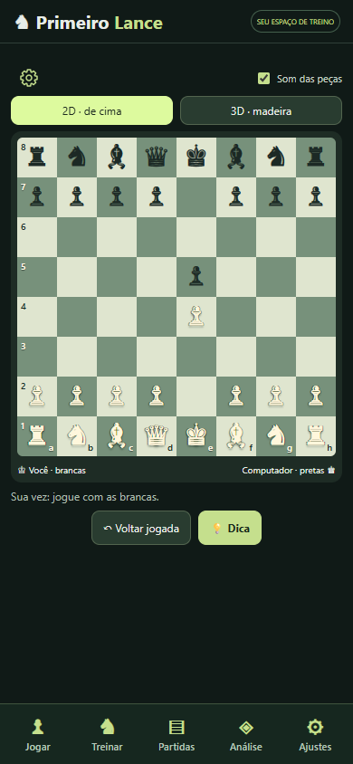
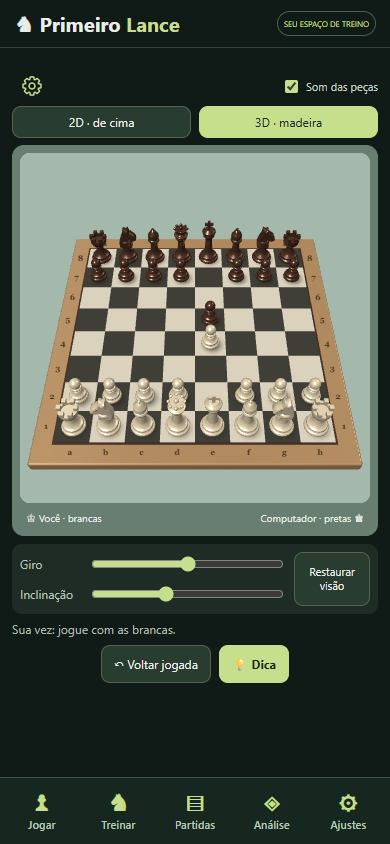

# ♞ Primeiro Lance

**Seu espaço para aprender xadrez, jogar com calma e estudar cada decisão.**

Treinador de xadrez em português do Brasil, com tabuleiro 2D/3D, motor Stockfish local e ferramentas para estudar partidas e livros.

[**Baixar o aplicativo Android**](https://github.com/aens1984/primeiro-lance/releases/latest) · [Instalação](#instalação-no-android) · [Compilação](docs/COMPILAR.md) · [Licenças](THIRD_PARTY.md)

  
  

## O que o app oferece

- **Jogue e treine:** partidas contra o computador, níveis de dificuldade, dicas e exercícios de mate.
- **Stockfish no próprio celular:** análise e respostas locais, sem depender de um notebook ligado. Se o motor falhar, o app informa quando usa o adversário básico.
- **Tabuleiro 2D e 3D:** giro, inclinação, estilos de peças, cores e som.
- **Menu inferior:** Jogar, Treinar, Partidas, Análise e Ajustes, com painéis que preservam a posição ao navegar.
- **Estudo de partidas:** importação de PGN/FEN, navegação pelos lances, biblioteca e favoritos.
- **Do livro ao tabuleiro:** extração de texto de PDFs e OCR local de imagens ou páginas escaneadas, com revisão da notação antes de aplicar.
- **Aprenda com as decisões:** comentários por lance e revisão da partida. A nota e a estimativa de rating são modelos experimentais.
- **Dados no aparelho:** preferências, sessão e biblioteca local, com exportação e restauração de backup no Android.

## Instalação no Android

1. Abra [Releases](https://github.com/aens1984/primeiro-lance/releases) e baixe **Primeiro-Lance.apk**.
2. Abra o arquivo no celular. Se o Android solicitar, autorize a instalação para o aplicativo usado para abrir o APK.
3. Inicie **Primeiro Lance** e confira a indicação de Stockfish conectado localmente.

O pacote atual é para **Android 11 ou superior, ARM64**. Não precisa de Termux ou Android Studio para usar. Jogar, analisar e processar arquivos locais não exige internet; baixar novas coleções exige conexão.

**Estado atual: versão experimental 1.1.1.** A compilação, assinatura e interface foram verificadas; esta versão ainda precisa de confirmação em um celular físico. Ao instalar uma atualização do mesmo projeto, prefira atualizar a instalação existente e guarde um backup dos seus dados.

## Limites conhecidos

- O rating de uma partida **não equivale a Elo FIDE, Chess.com ou Lichess** e não foi calibrado contra ratings humanos.
- O OCR pode errar símbolos e letras. Confira a transcrição; a legalidade dos lances não comprova a fidelidade ao livro.
- O leitor PGN acompanha a linha principal; variantes não são exibidas.
- Preferências e dados de cada instalação não são sincronizados automaticamente entre aparelhos.
- A versão web isolada usa o adversário básico; o APK integra o Stockfish local. Os fontes desta publicação incluem a interface e a edição Android.

## Para quem quer estudar o código

O código da interface está em `work/template.html`; os módulos de tabuleiro e navegação ficam em `work/`. A integração Android está em `work/android/`.

Consulte [como compilar](docs/COMPILAR.md), [privacidade](docs/PRIVACIDADE.md) e [notas da versão](CHANGELOG.md).

## Contribuições e problemas

Sugestões e relatos de problemas são bem-vindos em **Issues**. Informe a versão, o modelo do aparelho, o Android e os passos para reproduzir. Evite enviar backups, chaves ou documentos pessoais; para erros de xadrez, uma posição FEN ou uma partida de exemplo costuma ajudar.

## Licença e créditos

Primeiro Lance é disponibilizado sob **GNU GPL v3**. As dependências mantêm suas próprias licenças e créditos, descritos em [THIRD_PARTY.md](THIRD_PARTY.md).

O motor é desenvolvido pela comunidade [Stockfish](https://stockfishchess.org/). Esta é uma aplicação independente, sem vínculo oficial com o projeto Stockfish ou com plataformas de xadrez.
